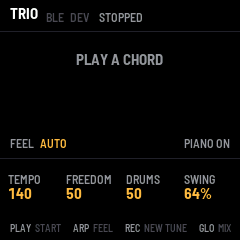
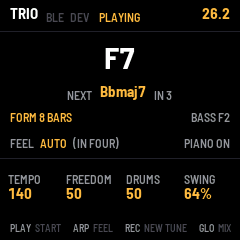
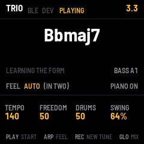
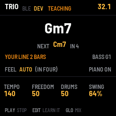
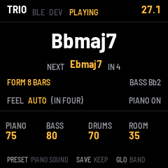
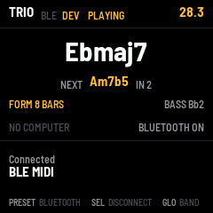

# TRIO

TRIO turns the M-VAVE FM-1 into a jazz rhythm section that listens. Play chords on the FM-1's keys or on a MIDI
keyboard or digital piano, by cable or over Bluetooth, and a walking bass and a drummer play along with you. Both
are small neural networks running on the FM-1 itself. The bass learned from FiloBass, 48 transcribed walking-bass
lines from jazz records. The drummer learned from JazzSAMBA, studio recordings of jazz standards. TRIO works out
each chord as you play it. Once your chords come round again, it learns the tune's form and knows what comes next.
Play the bass a walking line of your own, and it learns from you: from then on it walks more the way you do.

---

## Contents

1. Install
2. Quick start
3. The screen
4. Controls
5. How the band listens
6. The feel
7. Teaching the bass
8. The mix
9. Saving
10. MIDI and audio
11. The screen reader
12. Troubleshooting
13. How it works

---

## 1. Install

**Try it first:** [the emulator](https://reytian.github.io/fm1-trio/emu/) runs the same code in the browser, with
sound. Play it with the mouse, the computer keyboard, or a MIDI keyboard plugged into the computer. Chrome or Edge
asks once to allow MIDI.

**Install from the browser:** in Chrome or Edge, connect the FM-1 by USB, open
[the installer](https://reytian.github.io/fm1-trio/install/) and press Install. The browser asks once to allow MIDI:
allow it. Don't unplug the cable while it writes. It takes about a minute.

**Install from a terminal:** download `trio-VERSION.fwsc` from the
[releases](https://github.com/Reytian/fm1-trio/releases), then, in a clone of the repository,
`python3 base/tools/fm1_install.py trio-VERSION.fwsc` (it needs Python's `mido` and `python-rtmidi`).

**Back to the stock firmware:** the installer's last section writes M-VAVE's own firmware back. An FM-1 that
doesn't start can be recovered too. For details, see felucca-bsp's `tools/fm1_rescue.sh`.

---

## 2. Quick start

1. Press **PLAY**. The band counts a bar in (the screen counts 4, 3, 2, 1).
2. Play a chord, with its root as the lowest note: for example C, E♭, G, B♭ for Cm7. The bass and the drums
   start on the next beat.
3. Play each new chord a little before its bar, up to about an eighth note early, as a pianist does. The bass then
   lands on the new chord's root with you.
4. Keep going round the tune. After the chords have come round once, the screen says **FORM 8 BARS** (or however
   long your tune is), and **NEXT** shows what the band expects next.
5. Press **PLAY** again to stop.

TEMPO (K1) sets the speed: TRIO keeps its own time, so follow the band.

---

## 3. The screen

| Part | What it shows |
| --- | --- |
| Header | TRIO, then STOPPED, COUNT IN or PLAYING (TEACHING while you teach the bass), and the bar and beat (26.2 is bar 26, beat 2). A message replaces it for a moment after you change something. While Bluetooth is on, BLE lights while a computer or tablet is connected, and DEV while a Bluetooth keyboard or piano is; both are dim while nothing is connected. |
| Chord | The chord the band is playing now, in large type. |
| NEXT | The chord the band expects next, and in how many beats. NEXT, in the bright colour, comes from the form TRIO has learned. NEXT?, in the dimmer colour, is the network's guess before it knows the form. |
| FORM | FORM 8 BARS once the tune has come round; LEARNING THE FORM before that. While you teach the bass: YOUR LINE and how many bars of it TRIO keeps, then LEARNING YOUR LINE. |
| BASS | The bass's last note (while you teach it, yours). TAUGHT: the bass has learned from you. |
| FEEL | AUTO, TWO or FOUR. With AUTO, whether the band is in two or in four right now. |
| PIANO | PIANO ON: TRIO sounds your notes. PIANO OFF: a piano of your own sounds them. |
| Knobs | What K1 to K4 set on this page. A value lights for a moment as you turn it. |
| Footer | What the buttons do on this page. |

---

## 4. Controls

| Control | What it does |
| --- | --- |
| Keys | Play chords. TRIO's piano sounds them, louder the harder you play. F3 is the lowest key; OCT− and OCT+ move them. |
| PLAY (or SEQ) | Start: a bar's count-in, then the band. Press again to stop. |
| K1 TEMPO | 60 to 260 beats a minute. |
| K2 FREEDOM | How adventurous the bass is, from 0 to 100. Low: it plays the notes it's surest of. High: it takes more chances. |
| K3 DRUMS | How much the drummer plays, from 0 to 100. Low: quiet time, as under a bass solo. Middle: as behind a piano solo. High: as behind a horn. |
| K4 SWING | The swung eighth, from 50% (straight) to 75% (hard swing). 64% is a relaxed medium swing. |
| ARP | The feel: AUTO, TWO or FOUR (see The feel). |
| REC | A new tune: TRIO forgets the form and the chords so far. |
| GLO | The mix page and back (see The mix). |
| SEL | The Bluetooth page: connect a Bluetooth MIDI keyboard or piano, or switch Bluetooth on or off (see MIDI and audio). |
| EDIT | Teach the bass: TRIO's bass stops and you play it, from E1 to G3. Press again, or STOP, and it learns your line. Hold for 1.5 seconds: the bass as trained (see Teaching the bass). |
| OCT− · OCT+ | The keys an octave down or up, from −2 to +1. |
| SAVE | Saves the settings, and what the bass has learned. SAVE lights while there's something to save. |
| MASTER | The volume. |

---

## 5. How the band listens

**Chords.** TRIO listens to the notes you hold, or have just played, and names the chord: major 7, dominant 7,
minor 7, half-diminished, diminished, 7sus or augmented, on any root. Two notes are enough. Play the root as the
lowest note at each change: TRIO recognises rooted chords almost every time (97 to 98% in its tests). Rootless
voicings are ambiguous: B♭, D, F, A is B♭maj7, and also Gm7 without its G. TRIO then guesses, and is right only
about one time in five.

**Timing.** A chord played up to about an eighth note before a beat counts for that beat, and the bass lands on it.
A chord played on the beat comes too late for the bass on that beat, because a bass player decides a moment ahead.
The bass plays the old chord for that beat and follows on the next. Once TRIO knows the form, it plays the change on
the beat even when you play it exactly on the beat.

**The form.** TRIO keeps every chord with its beat. Once the chords come round again, for example the second time
through Autumn Leaves' A section, it knows the form: 8, 12, 16 or 32 bars, whatever the tune is. From then on:

- The bass walks toward each change before it comes, as a bass player who knows the tune does.
- **Stop playing, and the band keeps going round the form on its own.** Take a solo with your right hand, or listen.
- **Play a different chord** (a substitution, a new section) and the band goes with you. That one chord makes
  TRIO drop the form. It finds the form again once your chords repeat.
- **Hold a chord across a change** and the band moves on with the form. To keep the band on your chord, play it
  again.

Press **REC** to start a new tune: TRIO forgets the form and the chords.

---

## 6. The feel

| Feel | What the band plays |
| --- | --- |
| AUTO | In two (the bass on beats 1 and 3) until the form has come round once, or for 16 bars, then in four (walking quarter notes). Trios often play a tune this way: the head in two, the solos in four. |
| TWO | In two all the way: the bass on beats 1 and 3, with pickups. |
| FOUR | Walking in four from the first bar. |

---

## 7. Teaching the bass

TRIO's bass can learn from you. Play it a walking line, and from then on it walks more the way you do: your notes
on the changes, your approach notes, your pickups.

1. Play the tune's chords round until the screen says FORM 8 BARS (or however long your tune is), then let go. The
   band keeps going round the form.
2. Press **EDIT**. The screen says TEACH BASS, and TEACHING in the header. TRIO's bass stops, and you are the bass:
   your single notes from E1 to G3 sound on the upright, and TRIO doesn't hear them as chords. On the FM-1's keys,
   press **OCT−** twice first: the keys then run from F1 to G3.
3. Walk a line, a note a beat, for a chorus or two. A note on the swung eighth after a beat is a pickup into the
   next, and TRIO learns those too. The screen counts the bars of YOUR LINE. TRIO keeps the last 32.
4. Press **EDIT** again, or **STOP**. The screen says LEARNING, and LEARNED YOUR LINE a second or so later. The bass
   walks again, the way you taught it, and TAUGHT shows beside its note.

**How closely it follows you** is FREEDOM (K2). At 0 the bass plays your line almost note for note on the same
chords: 93% of the beats in TRIO's tests. At 50, where TRIO starts, about half the beats. At 100 it only leans your
way. Before you teach it, it plays your note on about one beat in five.

**What it learns.** Your note for each place in a tune: the chord, the next chord and how far off it is, the beat in
the bar, and how long since the change. It learns the tune you teach it on most, but how you walk carries over: taught
on Autumn Leaves, it also walks a blues more your way, about half as much. A new lesson largely replaces the one
before. To teach it in two (ARP: TWO), play in two: notes on 1 and 3, held through 2 and 4.

**Chords while you teach.** From E1 to G3 is your line. Play chords from A♭3 up, with the root as their lowest note,
or let the form carry the band.

**From the first bar.** While the band is stopped, press EDIT (the screen says PRESS PLAY), then PLAY. You teach from
the first bar, over your own chords from A♭3 up.

**Forget.** Hold **EDIT** for 1.5 seconds: the bass goes back to how it was trained (BASS AS TRAINED).

**Keep it.** Press **SAVE**: what the bass learned comes back the next time the FM-1 starts.

If the screen says NOTHING LEARNED, the lesson had fewer than eight notes the bass could have played there. STILL
LEARNING: TRIO is learning the line before; press EDIT again in a moment.

---

## 8. The mix

Press **GLO** for the mix page:

| Control | What it does |
| --- | --- |
| K1 PIANO | The piano's volume. |
| K2 BASS | The bass's volume. |
| K3 DRUMS | The drums' volume. |
| K4 ROOM | How much room the trio plays in: from dry to a club. |
| PRESET | The piano's sound on or off. Turn it off when your MIDI keyboard or piano makes its own sound: TRIO then only listens. |

Press **GLO** again for the band page.

---

## 9. Saving

Press **SAVE** to keep every setting: the tempo, freedom, drums, swing, feel, the mix, the piano's sound, the
octave and whether Bluetooth is on, and what the bass has learned from you (see Teaching the bass). They come back
the next time the FM-1 starts. The form isn't saved: each time you start, TRIO learns the tune afresh.

---

## 10. MIDI and audio

MIDI comes in over USB, the TRS jack and Bluetooth: notes on any channel, and the sustain pedal (controller 64) for
TRIO's piano. A MIDI keyboard or a digital piano plays TRIO as the FM-1's keys do, with all ten fingers. Turn the
piano's sound off on the mix page (PRESET) if the keyboard sounds by itself.

- **USB:** from a computer, TRIO is a MIDI device named "TRIO FM-1". A keyboard plugged into the computer reaches
  it through your DAW, or through a MIDI routing utility.
- **TRS:** the FM-1's MIDI in jack, with a TRS-to-DIN adapter, takes a keyboard's MIDI out directly.
- **Bluetooth:** a digital piano or a keyboard with Bluetooth MIDI connects to the FM-1 directly, with no cable.
  A computer, an iPad or an iPhone can connect too.

Over the USB cable the FM-1 is also a sound card: a computer can record the trio (an input named "TRIO FM-1").

### Connecting a Bluetooth piano or keyboard

1. Switch on the piano's Bluetooth MIDI, so that it advertises (some pianos call this pairing mode). If a phone or
   a tablet is connected to the piano, disconnect it there first: a piano usually takes one Bluetooth MIDI
   connection at a time.
2. Press **SEL**. The Bluetooth page opens, and TRIO looks for MIDI devices. When it finds one, the screen shows its
   name.
3. If TRIO finds more than one, turn **ALGORITHM** to pick yours. ALGO 2/3 means the second of three.
4. Press **SEL** again. The screen says CONNECTING, then CONNECTED, and DEV lights in the header.
5. Press **GLO** to go back to the band page, and play.

A digital piano sounds by itself: turn TRIO's piano off on the mix page (PRESET), so that you hear one piano.

To disconnect, press **SEL** on the Bluetooth page. If the piano goes out of range or switches itself off, the
screen says DEVICE LOST, and TRIO lets go of any notes it was holding. TRIO doesn't connect again by itself: on the
Bluetooth page, wait for the piano's name, then press **SEL**.

TRIO finds devices that advertise Bluetooth MIDI. A piano whose Bluetooth only plays audio (music from a phone
through its speakers) can't connect.

| Control on the Bluetooth page | What it does |
| --- | --- |
| SEL | Connect to the device shown, or disconnect the one connected. |
| ALGORITHM | Pick a device, when TRIO finds more than one. |
| PRESET | Bluetooth on or off. |
| GLO | Back to the band page. |

### Connecting a computer, an iPad or an iPhone

Over Bluetooth, the FM-1 advertises as "FM-1". On a Mac, open Audio MIDI Setup, choose Window > Show MIDI Studio,
click the Bluetooth button, then Connect next to FM-1. On an iPad or an iPhone, connect from a music app's Bluetooth
MIDI settings. BLE lights in the header while it's connected. A computer and a piano can be connected at the same
time.

### Bluetooth on or off

Bluetooth is on when TRIO starts. To switch it off, open the Bluetooth page (SEL) and turn **PRESET**: the screen
says BLUETOOTH OFF, and the FM-1 stops advertising and drops its connections. Turn PRESET again to switch it back
on. Press **SAVE** to keep the choice for the next time the FM-1 starts.

If the FM-1 started with Bluetooth off, switching it on starts the radio, and the FM-1's sound stops for about a
second while the radio starts. So TRIO switches it on only while the band is stopped: during a tune, the screen says
STOP FIRST.

The emulator shows the Bluetooth page with a stand-in device named BLE MIDI. It can't reach real Bluetooth devices.

---

## 11. The screen reader

TRIO tells a screen reader what's on its screen, through the
[FM-1 Screen Reader](https://charlesvestal.github.io/fm1-reader/). When the reader starts listening, it hears
whether the band is playing, the chord, the tempo, the feel and the form, whether you're teaching the bass or it
has learned from you, and whether Bluetooth is off or what's connected over it. After that, it hears each change
as you make it.

---

## 12. Troubleshooting

**No sound:** turn MASTER up. The band plays only after PLAY. The piano sounds only with PIANO ON.

**The bass is late on the changes:** play each chord a little earlier, up to an eighth note before its beat. Or
play the tune round once: once the form is learned, the bass is on time.

**The wrong chord shows:** play the root as the lowest note, and three or four notes of the chord.

**TRIO hears the wrong chords while I teach the bass:** your notes from E1 to G3 are the bass line, not chords.
Play the chords from A♭3 up, with the root as the lowest note, or play the tune round first and teach over the form.

**The bass doesn't play my line after teaching:** turn FREEDOM (K2) down. At 0 it follows you most closely.

**LATE n in the header:** the networks missed n beats. This shouldn't happen. Please report it with what you were
doing.

**The Bluetooth page doesn't find the piano:** check that the piano's Bluetooth MIDI is on, and that no phone or
tablet is connected to it. Bring it closer. If the page says Bluetooth is off, turn PRESET.

**DEVICE LOST or NO ANSWER:** the piano went out of range, switched itself off, or didn't answer. Switch it on,
then connect again from the Bluetooth page.

**The installer doesn't find the FM-1:** use Chrome or Edge, allow MIDI when asked, and close other programs that
use the FM-1's MIDI port.

**The FM-1 doesn't start after an install:** after two failed starts it waits in the chip's update mode. Put the
stock firmware back, then install again. For details, see felucca-bsp's `tools/fm1_rescue.sh`.

---

## 13. How it works

Four networks run on the FM-1's chip. Together they hold 110,000 weights, stored as 8-bit numbers.

| Network | What it does | Learned from |
| --- | --- | --- |
| Chord | Names the chord from the notes you hold (a 3-layer perceptron) | 23,000 voicings |
| Harmony | Guesses the next chord and when it comes, before the form is known (a GRU) | 124 jazz standards' chord charts |
| Bass | Picks each beat's note and whether to add a pickup, from the chord, the next chord and its own last notes (a GRU) | FiloBass's 48 lines, and lines from a walking-bass model |
| Drums | Plays the kit 12 steps a bar (swung triplets): ride, snare, kick, hi-hat, cross-stick, toms, crash (a GRU) | JazzSAMBA's drum takes, 54 tunes |

The bass decides each note 40 ms before its beat; the drummer plays half a bar ahead. When you teach the bass, it
learns on the FM-1 itself. While you play, it listens to your line beat by beat, as the bass network would have heard
its own. Then it adjusts the network's last layer, the 3,500 weights that choose the note and the pickup, in about a
second, and keeps the rest as trained. The sound is synthesised on
the FM-1: an electric piano, an upright bass, a drum kit and a room. The bass is built from measurements of real
upright pizzicato in FiloBass's recordings: each partial's level and decay, by register, and the finger's attack.
Everything together uses about 40% of
the chip's time (estimated from the code's instruction counts).

TRIO is built on fm1-base by Charles Vestal, and felucca-bsp by Leo Kuroshita, Hügelton Instruments. The bass
learned from [FiloBass](https://aim-qmul.github.io/FiloBass/) (Riley and Dixon, ISMIR 2023; CC BY 4.0). The drummer
learned from [JazzSAMBA](https://github.com/pnlong/jazzsamba) (Copyright (c) 2026 Phillip Long and contributors).
See CREDITS.md.

M-VAVE and FM-1 are trademarks of their owners. TRIO is not affiliated with M-VAVE.
